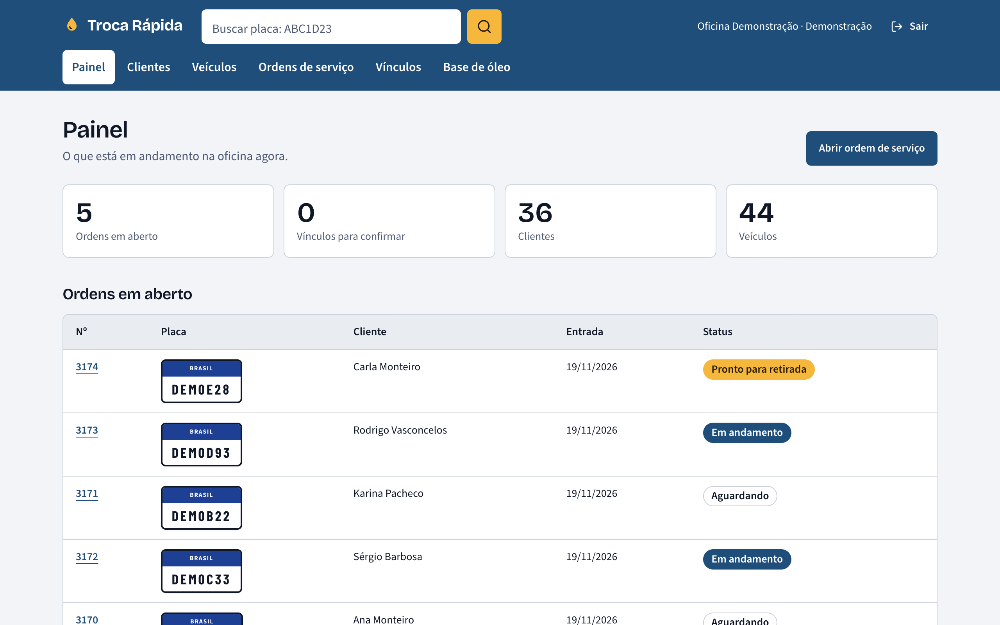
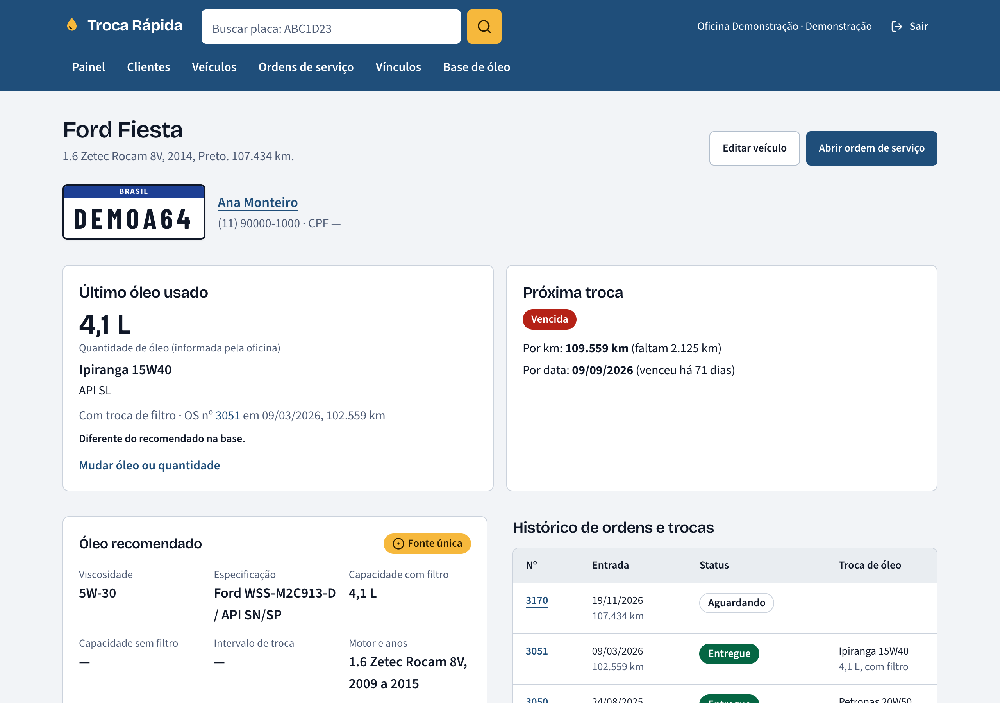
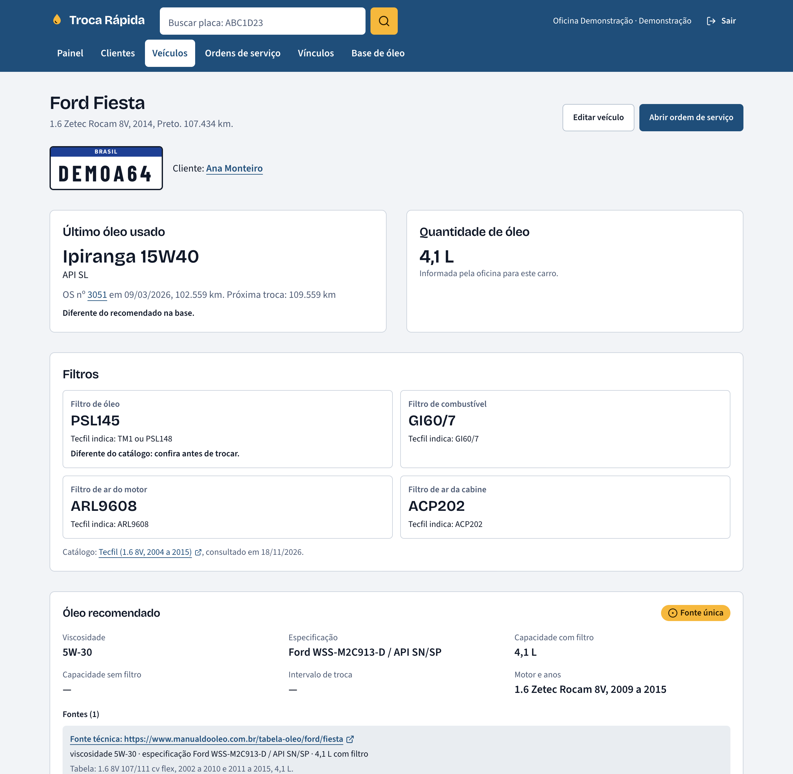
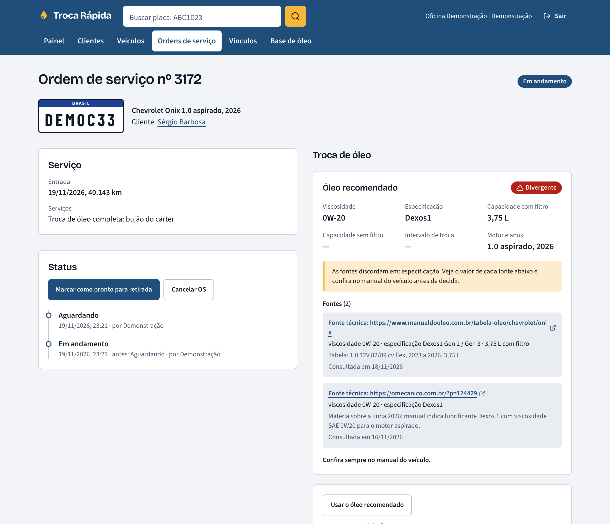
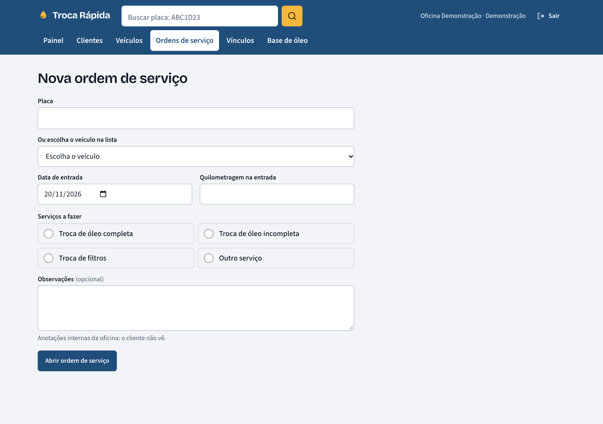
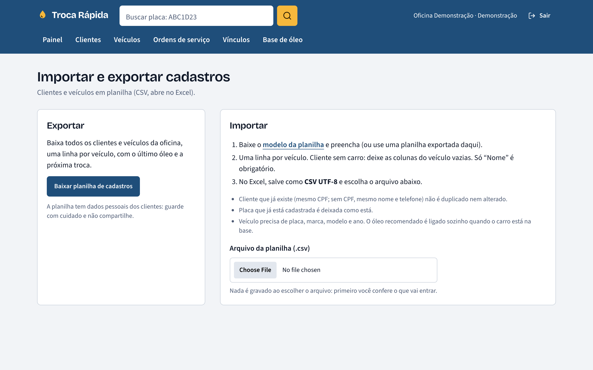
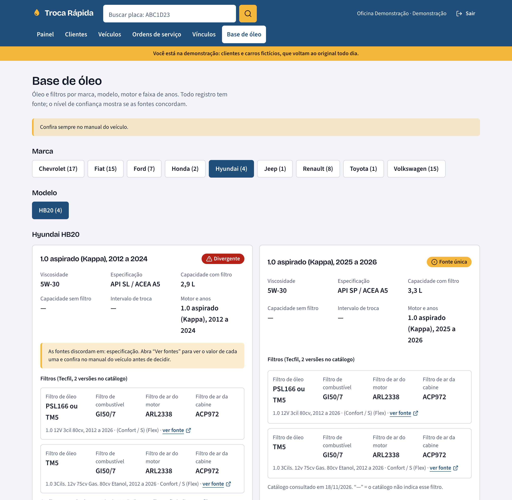

# Troca Rápida

[](https://github.com/TcharlesFerreira/troca-rapida/actions/workflows/testes.yml)

*[Versão em português](README.md)*

A web app for auto repair shops and oil-change centers in Brazil. Shops register customers and vehicles, open work orders, record every oil change and find everything by license plate. For each car, the system shows **the recommended oil and filters, with their sources**, warns when the shop used something different, and computes the next change by mileage and by date. Many shops share the same system, and each one only sees its own customers.

The UI is in Portuguese (Brazil).

**[Try the live demo](https://troca-rapida-one.vercel.app/login)**: on the login page, click **Entrar na demonstração** (no sign-up needed). Customers and cars are fictitious and reset every day. The first visit may take a few seconds while the free server wakes up.



> All screenshots use the **demo shop**, with fictitious customers and cars (`npm run db:seed:demo`).

## Features

| | |
|---|---|
| **Plate search** at the top of every page: partial plates, live suggestions, and a shortcut to register a plate that doesn't exist yet. |  |
| **Vehicle page**: last oil used, quantity, filters compared against the Tecfil catalog, recommended oil with sources, full history. |  |
| **Work orders** with a status flow (waiting → in progress → ready for pickup → delivered), an audit trail of who changed what, and the oil change form with the next change suggested from the oil viscosity. |  |
| **New work order** with service types (full, partial, filters only, other) and a sanity check: ticking every filter on a "partial" change asks whether it is actually a full one. |  |
| **Spreadsheet import/export** of customers and vehicles, with a line-by-line review before anything is saved and no duplicates. |  |
| **Oil and filter database with sources**: every recommendation keeps where it came from; confidence (confirmed, single source, conflicting) is computed, never typed in. Catalog filters show on the same card and are pre-filled when a car is registered. |  |

Also: customer area (customers sign up and follow their services and next oil change), automatic or approval-based linking between a customer account and the shop's record, a super admin who registers shops, safe deletion (history is never erased), login attempt limits, pagination and mobile-friendly pages.

## Technical decisions

- **Next.js 15 (App Router) + React 19 + TypeScript**, with Server Components and Server Actions: UI and backend in one project, no separate REST API.
- **PostgreSQL + Prisma** with versioned migrations. Uniqueness is per shop (`@@unique([empresaId, placa])`, `[empresaId, cpf]`).
- **Multi-tenant isolation in the service layer**: every query starts from the logged-in user's shop (`exigirAdmin(ator)`), and the tests use a fake database that really applies the `where` clause, so a missing tenant filter breaks the build.
- **Auth.js** with email and password (bcrypt). The user's role is re-read from the database on every request. Repeated failed logins are throttled per email and per IP.
- **Business rules as pure functions** (`src/lib`), independent of the database: work-order status flow, oil-change interval by viscosity, CSV parsing, Brazilian ID (CPF) and plate validation. They make up most of the **100+ tests (Vitest)**, which run on GitHub Actions on every push.
- **Zod** for server-side form validation, with accessible forms (labels, `aria-*`, focus handling).
- **Oil data is never made up**: the seed rejects records without a source and blocks forums and stores as sources.
- **Public demo**: a demo shop flagged in the database can't delete or import records, and a Vercel Cron job rebuilds its fictitious data every day.

## Running locally

Requirements: **Node 20+** and **Docker**.

```bash
npm install
npm run setup:env        # creates .env with random secrets
npm run db:up            # PostgreSQL in Docker
npm run db:deploy        # applies the migrations
npm run db:seed          # super admin + oil database + filter catalog
npm run db:seed:demo     # optional: demo shop (demo@troca-rapida.local / demonstracao)
npm run dev              # http://localhost:3000
```

`npm test` runs the test suite and `npm run typecheck` checks the types. Deployment notes (Vercel + Neon, AWS) are in the Portuguese README, section *Como migrar*.

## License

© Tcharles Ferreira. All rights reserved. The code is public for viewing only (portfolio): copying, modifying, distributing or using it commercially requires permission. See [LICENSE](LICENSE).
