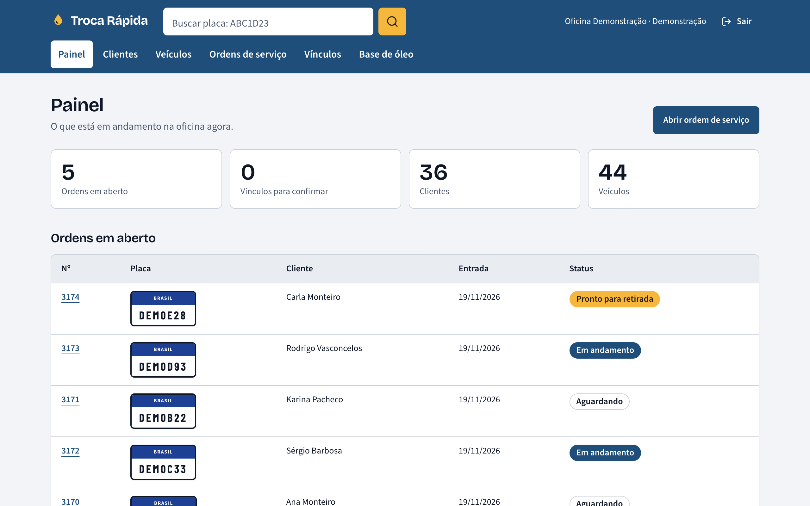
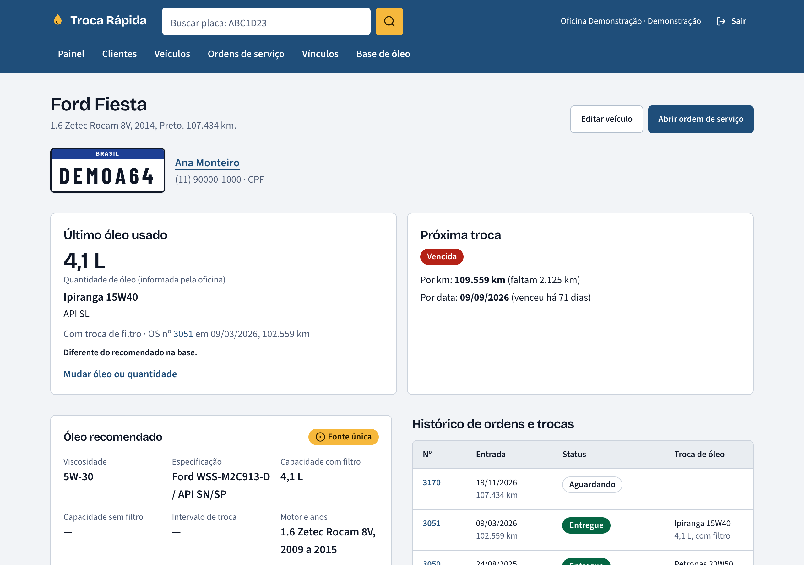
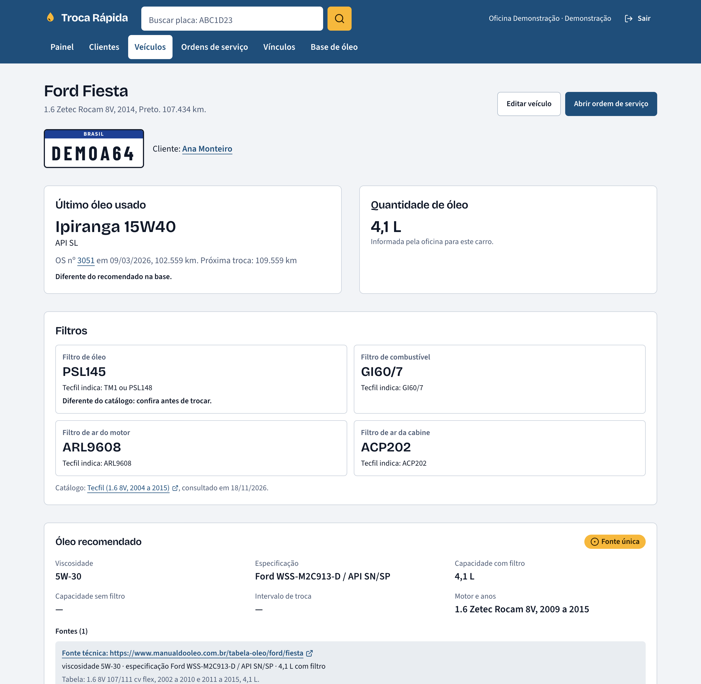
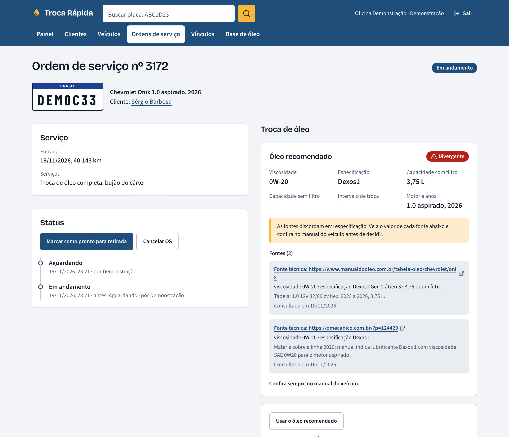
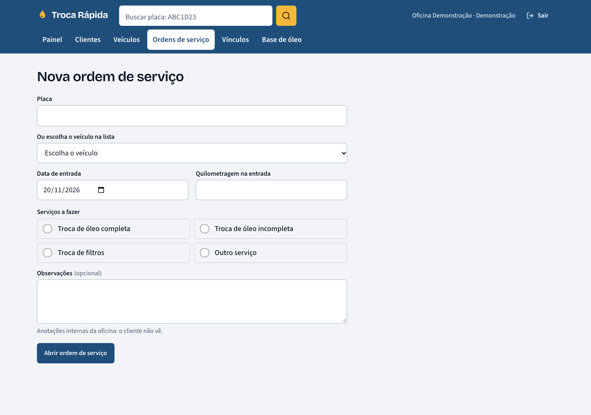
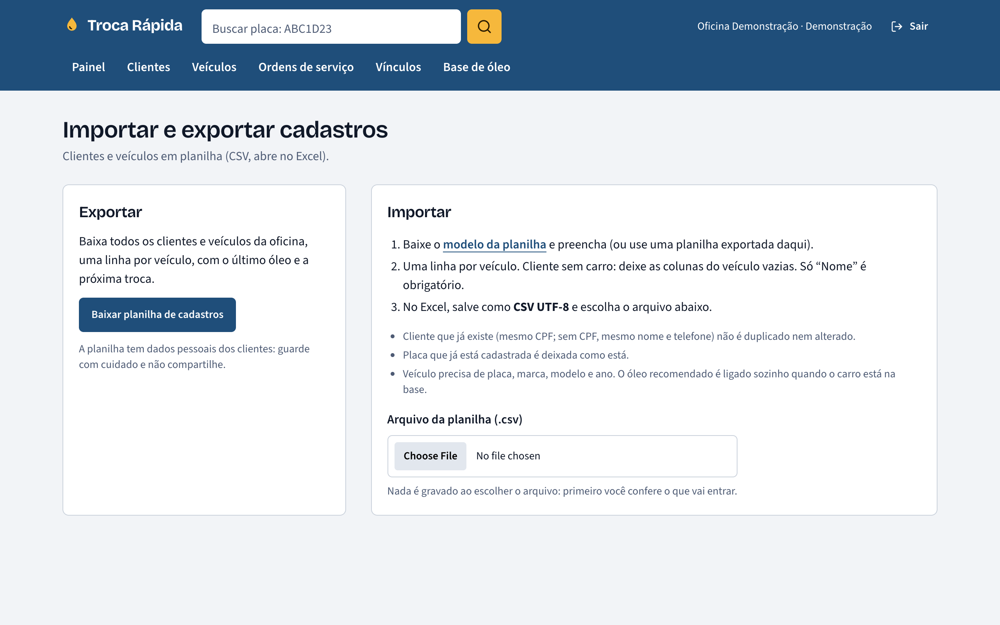
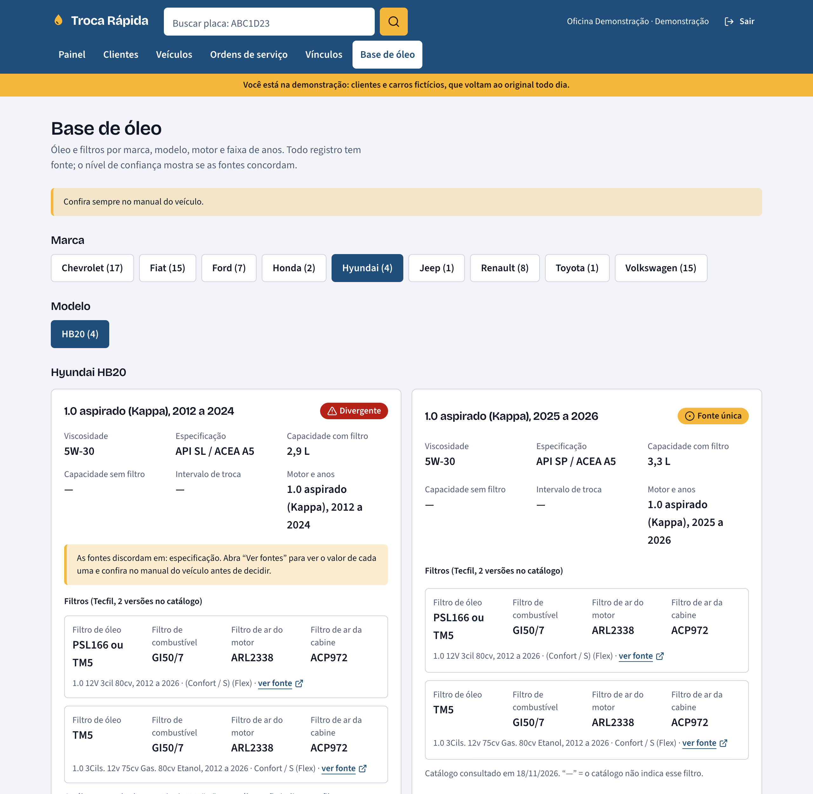

# Troca Rápida

[](https://github.com/TcharlesFerreira/troca-rapida/actions/workflows/testes.yml)

*[English version](README.en.md)*

Sistema web para oficinas mecânicas e centros de troca de óleo. A oficina cadastra clientes e veículos, abre ordens de serviço, registra cada troca de óleo e encontra tudo pela placa. Para cada carro, o sistema mostra **o óleo e os filtros recomendados, com as fontes**, avisa quando a oficina usou algo diferente e calcula a próxima troca por km e por data. Várias oficinas usam o mesmo sistema, cada uma vendo só os próprios clientes.

**[Ver a demonstração online](https://troca-rapida-one.vercel.app/login)**: na tela de login, clique em **Entrar na demonstração** (sem cadastro). Os clientes e carros são fictícios e voltam ao original todo dia. O primeiro acesso pode levar alguns segundos enquanto o servidor gratuito acorda.



> Todas as imagens usam a **oficina de demonstração**, com clientes e carros fictícios (`npm run db:seed:demo`).

## O que o sistema faz

| | |
|---|---|
| **Busca por placa** no topo de todas as telas, aceitando só parte da placa, com sugestões e atalho para cadastrar a placa que não existe. |  |
| **Ficha do veículo**: último óleo, quantidade, filtros comparados com o catálogo Tecfil, óleo recomendado com as fontes e o histórico completo. |  |
| **Ordem de serviço** com status (aguardando → em andamento → pronto para retirada → entregue), histórico de quem mudou o quê e registro da troca de óleo com a próxima troca sugerida pela viscosidade. |  |
| **Abertura de OS** escolhendo o serviço (troca completa, incompleta, filtros, outro), com conferência: se marcar todos os filtros numa troca "incompleta", o sistema pergunta se ela é completa. |  |
| **Importar e exportar** clientes e veículos em planilha, com conferência linha a linha antes de gravar e sem duplicar cadastros. |  |
| **Base de óleo e filtros com fontes**: cada recomendação guarda de onde veio; a confiança (confirmado, fonte única, divergente) é calculada, nunca digitada. Os filtros do catálogo aparecem no mesmo cartão e já vêm preenchidos ao cadastrar um carro. |  |

Também: área do cliente (ele cria a conta e acompanha os serviços e a próxima troca), ligação automática ou com aprovação entre a conta do cliente e o cadastro da oficina, superadministrador que cadastra as oficinas, exclusão segura (não apaga histórico), paginação e telas que funcionam no celular.

## Decisões técnicas

- **Next.js 15 (App Router) + React 19 + TypeScript**, com Server Components e Server Actions: telas e backend no mesmo projeto, sem API REST separada.
- **PostgreSQL + Prisma**, com migrações versionadas. Unicidade por oficina (`@@unique([empresaId, placa])`, `[empresaId, cpf]`).
- **Isolamento entre oficinas na camada de serviço**: toda consulta parte da empresa de quem está logado (`exigirAdmin(ator)`), e os testes usam um banco falso que aplica o `where` de verdade. Se alguém esquecer o filtro, o teste quebra.
- **Auth.js** com e-mail e senha (bcrypt). O papel do usuário é relido do banco a cada requisição.
- **Regras de negócio em funções puras** (`src/lib`), sem depender do banco: status da OS, intervalo de troca por viscosidade, leitura de planilha, validação de CPF e placa. São a maior parte dos **100+ testes (Vitest)**, que rodam no GitHub a cada envio.
- **Zod** para validar formulários no servidor, com mensagens em português e acessibilidade (rótulos, `aria-*`, foco).
- **Dados de óleo nunca inventados**: o seed recusa registro sem fonte e bloqueia fóruns e lojas como fonte.

## Como rodar localmente

Requisitos: **Node 20+** e **Docker**.

```bash
# 1. Dependências
npm install

# 2. Cria o .env com segredos aleatórios (não sobrescreve um .env existente).
#    Anote o e-mail e a senha do administrador que ele mostra.
npm run setup:env

# 3. Sobe o PostgreSQL em Docker
npm run db:up

# 4. Cria as tabelas (aplica as migrações de prisma/migrations)
npm run db:deploy

# 5. Cria o administrador e carrega a base de óleo (pode rodar de novo sem duplicar nada)
npm run db:seed

# 6. (Opcional) Oficina de demonstração com clientes e carros fictícios
#    Entra com demo@troca-rapida.local / demonstracao
npm run db:seed:demo

# 7. Abre o sistema
npm run dev
```

Acesse http://localhost:3000 e entre com o e-mail e a senha do administrador (`ADMIN_EMAIL` e `ADMIN_PASSWORD` do `.env`). Clientes se cadastram em `/cadastro`.

Se preferir não usar o `setup:env`, copie `.env.example` para `.env` e preencha tudo (a `DATABASE_URL` precisa combinar com `POSTGRES_USER`, `POSTGRES_PASSWORD` e `DB_PORT`; o `AUTH_SECRET` pode ser gerado com `openssl rand -base64 32`).

### Comandos úteis

| Comando | O que faz |
|---|---|
| `npm run dev` | Servidor de desenvolvimento |
| `npm run build` / `npm start` | Build e execução de produção |
| `npm test` | Testes automatizados (Vitest) |
| `npm run typecheck` | Confere os tipos do TypeScript |
| `npm run db:studio` | Interface para ver o banco |
| `npm run db:down` | Para o PostgreSQL (os dados ficam no volume Docker) |

## Como o sistema funciona

### Quem usa

- **Superadministrador (dono do sistema):** em `/superadmin`, cadastra as empresas (oficinas) e o administrador de cada uma. Não vê clientes de nenhuma empresa. É criado pelo seed com `SUPERADMIN_EMAIL` e `SUPERADMIN_PASSWORD`.
- **Administrador (uma empresa):** clientes, veículos, OS, trocas de óleo, busca por placa, vínculos pendentes e consulta da base de óleo, **só da própria empresa**. Não existe cadastro público de administrador: o superadministrador cria um por empresa (o seed pode criar o da primeira empresa com `EMPRESA_NOME`, `ADMIN_EMAIL` e `ADMIN_PASSWORD`).
- **Cliente:** cria a própria conta e vê só os seus veículos, serviços em andamento, histórico e próxima troca de óleo, em todas as oficinas em que tem cadastro confirmado.

### Filtros

Cada carro guarda os filtros que a oficina usa (óleo, combustível, ar do motor e ar da cabine). A tela do veículo mostra, ao lado, o que o catálogo do fabricante indica e avisa quando o código é diferente. O catálogo fica em `data/filtros/*.json` (hoje, Tecfil), carregado pelo seed; cada aplicação guarda a página consultada e a data. Os códigos são comparados sem espaço/hífen, e o "GL" das fichas antigas é lido como o "GI" da Tecfil.

### Importar e exportar cadastros

Em **Clientes → Importar / exportar** (`/admin/cadastros`):

- **Exportar** baixa um CSV (abre no Excel) com todos os clientes e veículos da oficina, uma linha por veículo, mais o último óleo e a próxima troca.
- **Importar** recebe um CSV (modelo para baixar na mesma tela; aceita `;`, `,` ou tabulação, UTF-8 ou o formato antigo do Excel no Windows, e vários nomes de coluna, como "Celular" ou "Quilometragem"). Antes de gravar, mostra a conferência linha a linha. Cliente que já existe (mesmo CPF; sem CPF, mesmo nome e telefone) não é duplicado nem alterado; placa já cadastrada fica como está; linha com erro não entra. A gravação é tudo ou nada e confere tudo de novo no servidor. Máximo de 5.000 linhas por arquivo.

### Próxima troca

Ao registrar a troca, a data da próxima vem preenchida com **6 meses** depois da entrada e a quilometragem sai da viscosidade (0W20 a 5W40: +10 mil km; 10W30 a 15W40: +7 mil; 20W50 a 25W60: +5 mil). A oficina pode mudar as duas.

### Empresas

Cada empresa tem os próprios clientes, veículos e ordens de serviço. CPF e placa são únicos **dentro** da empresa: o mesmo carro pode ter cadastro em duas oficinas, e uma não vê o da outra. Todo serviço de administrador filtra pelo `empresaId` da sessão (`exigirAdmin` devolve esse id), e `tests/isolamento-empresa.test.ts` quebra se algum esquecer. A base de óleo é a mesma para todas.

### Ligação da conta do cliente com o cadastro da oficina

A oficina pode cadastrar o cliente antes de ele criar conta. No cadastro do cliente:

| Situação | Resultado |
|---|---|
| CPF **e** e-mail iguais ao cadastro da oficina | Conta ligada na hora |
| Só o CPF igual | Vínculo **pendente**: o administrador confirma em *Vínculos* (evita que alguém digite o CPF de outra pessoa e veja os carros dela) |
| Nenhum cadastro com o CPF | Conta criada, esperando a oficina |

Se a oficina cadastrar o cliente *depois* de ele ter criado a conta, a mesma regra vale no sentido inverso.

### Busca por placa

O campo no topo da área administrativa aceita `ABC1234` e `ABC1D23`, com ou sem hífen, maiúscula ou minúscula. A placa é sempre guardada em maiúscula e sem hífen. A tela mostra o cliente, o **último óleo usado e a quantidade**, a próxima troca prevista (e se já venceu por km ou por data), o óleo recomendado e todo o histórico.

## Base de óleo

A base fica em arquivos JSON, **um por marca**, em `data/oleo/`, e é carregada no banco pelo `npm run db:seed`. A organização é marca → modelo → motor → faixa de anos, porque o óleo depende do motor e do ano, não só do modelo.

### Regras

1. **Nunca inventar informação de óleo.** Registro sem fonte não entra: o seed recusa e diz o motivo.
2. Fontes preferidas, nesta ordem: manual do proprietário ou site da montadora (`MONTADORA`); ferramenta "qual óleo usar" do fabricante de lubrificante (`LUBRIFICANTE`); outras fontes técnicas (`TECNICA`). **Nunca** fórum, rede social, anúncio ou opinião (o validador bloqueia os domínios mais comuns).
3. A **confiança não é escrita no JSON**: é calculada a partir das fontes.
   - **Confirmado:** dois sites independentes concordam em viscosidade e especificação.
   - **Fonte única:** só um site informa. Várias páginas do mesmo site contam como uma fonte.
   - **Divergente:** dois sites discordam em algum campo. O sistema guarda as duas e mostra o aviso.
4. O valor "oficial" de cada campo vem da fonte de maior prioridade que o informa; as demais continuam visíveis na tela.

### Formato de um arquivo

```json
{
  "marca": "Chevrolet",
  "modelos": [
    {
      "nome": "Onix",
      "motores": [
        {
          "motor": "1.0 turbo",
          "anos": [2023, 2024],
          "fontes": [
            {
              "tipo": "MONTADORA",
              "url": "https://...",
              "consultadaEm": "2026-11-16",
              "observacao": "texto opcional, ex.: página do manual",
              "dados": {
                "viscosidade": "5W-30",
                "especificacao": "Dexos1 Gen 3 API SP",
                "capacidadeComFiltroL": 3.5,
                "capacidadeSemFiltroL": 3.3,
                "intervaloKm": 10000,
                "intervaloMeses": 12
              }
            }
          ]
        }
      ]
    }
  ]
}
```

Só `viscosidade` e `especificacao` são obrigatórias (em alguma fonte). Os demais campos entram quando a fonte informa. Faixas de anos do mesmo motor não podem se sobrepor.

### Estado atual

A base tem **70 registros de motor e faixa de anos**, de 22 modelos populares de 9 marcas (Chevrolet, Fiat, Ford, Honda, Hyundai, Jeep, Renault, Toyota e Volkswagen), de 2009 a 2026: 5 confirmados por duas fontes, 47 com fonte única e 18 em que as fontes discordam (o sistema mostra as duas). As fontes atuais são técnicas; ainda faltam os manuais das montadoras. O catálogo de filtros tem 1.572 aplicações Tecfil de 52 modelos. Antes de confiar em qualquer registro, **confira no manual do veículo**.

Para ampliar: adicione ou edite um JSON, rode `npm test` (ele valida todos os arquivos) e `npm run db:seed`.

## Segurança

- Toda página e toda ação conferem **quem está logado e o que pode ver** (ver `src/lib/sessao.ts`). O papel e o vínculo do usuário são lidos do banco a cada requisição, não só do token.
- O cliente só acessa os próprios dados: toda consulta da área do cliente parte do `clienteId` da sessão (`src/servicos/area-cliente.ts`). Um id de outro cliente simplesmente não é encontrado. Isso é testado em `tests/isolamento-cliente.test.ts`.
- Senhas guardadas com hash (bcrypt). Nenhum segredo no código: tudo vem do `.env`, que **nunca** vai para o git.
- **Limite de tentativas de login:** 5 erros seguidos com o mesmo e-mail, ou 20 vindos do mesmo endereço, bloqueiam por 15 minutos (`src/lib/limite-login.ts`). A conta pública de demonstração só é limitada pelo endereço, para nenhum visitante conseguir trancá-la.
- A oficina de demonstração (`Empresa.demonstracao`) não deixa excluir nem importar cadastros.

## Estrutura de pastas

```
prisma/            schema.prisma, migrations/, seed.ts
data/oleo/         um JSON por marca (base de óleo, com fontes)
src/
  app/             telas: (publico) login e cadastro, (admin)/admin, (cliente)/minha-area
  acoes/           ações dos formulários (cada uma confere o login primeiro)
  servicos/        regras de negócio e consultas ao banco (checam permissão)
  components/      ui/ (estilo shadcn) e componentes do sistema
  lib/             funções puras (placa, CPF, vínculo, status, óleo), validação, sessão
  auth.ts          configuração do Auth.js (auth.config.ts roda no middleware)
tests/             testes automatizados
```

Nomes do domínio em português (`Cliente`, `Veiculo`, `OrdemServico`, `TrocaOleo`); termos técnicos do framework em inglês.

## Como migrar

O projeto foi feito para a mudança ser pequena: toda configuração vem de variáveis de ambiente, nada é salvo no disco do servidor e nada depende da sua máquina.

### Vercel + Neon (é assim que a demonstração pública roda)

1. **Vercel:** entre com a conta do GitHub e importe o repositório. O `package.json` tem o script `vercel-build` ([scripts/vercel-build.sh](scripts/vercel-build.sh)), que a Vercel usa sozinha: gera o Prisma, aplica as migrações, roda o seed e compila.
2. **Banco:** no projeto da Vercel, aba *Storage* → *Create Database* → **Neon** (plano gratuito), ligado ao projeto. A Vercel cria `DATABASE_URL` (com pool, usada pelo site) e `DATABASE_URL_UNPOOLED` (direta, usada nas migrações e no seed).
3. **Variáveis** (*Settings → Environment Variables*):
   - `AUTH_SECRET`: novo, gerado com `openssl rand -base64 32`;
   - `AUTH_TRUST_HOST=true`;
   - `SUPERADMIN_EMAIL` e `SUPERADMIN_PASSWORD` (senha forte, 10+ caracteres);
   - para a **demonstração pública**: `DEMO_PUBLICA=true` e `CRON_SECRET` (outro valor aleatório). **Não** defina `EMPRESA_NOME`/`ADMIN_*`: o banco da demonstração só tem dados fictícios.
4. Publique (*Deploy*). Com `DEMO_PUBLICA=true`, a tela de login ganha o botão **Entrar na demonstração**, e o [Cron da Vercel](vercel.json) recria os dados fictícios todo dia às 3h (horário de Brasília). Na demonstração, ninguém consegue excluir nem importar cadastros.
5. **Sistema de verdade (com clientes reais):** use outro projeto e outro banco, **sem** `DEMO_PUBLICA`, com `EMPRESA_NOME`, `ADMIN_EMAIL` e `ADMIN_PASSWORD` para criar a primeira oficina.

Supabase também serve: use a conexão do *Session pooler* (porta 5432) em `DATABASE_URL`.

### AWS

1. **Banco:** crie uma instância PostgreSQL no **Amazon RDS** (ou Aurora PostgreSQL) em subnets privadas, com um security group que só aceite conexões do app. Monte a `DATABASE_URL` com o endereço dela.
2. **App:** o caminho mais simples é o **AWS Amplify Hosting** (Next.js direto do GitHub). Alternativa: empacotar em Docker e publicar no **App Runner** ou **ECS Fargate** (adicione `output: "standalone"` no `next.config.mjs` e um `Dockerfile`).
3. **Segredos:** guarde `DATABASE_URL` e `AUTH_SECRET` no **Secrets Manager** ou no **SSM Parameter Store** e injete como variáveis de ambiente. Defina `AUTH_TRUST_HOST=true` atrás de load balancer.
4. **Migrações e seed:** rode `npx prisma migrate deploy` e `npm run db:seed` a partir de uma máquina com acesso ao banco (um bastion, VPN ou uma tarefa única no ECS), com as variáveis apontando para o RDS.
5. Coloque HTTPS na frente (CloudFront ou Application Load Balancer com certificado do ACM).

### Cuidados nas duas

- Gere um `AUTH_SECRET` **novo** na nuvem (não reaproveite o local).
- Troque a senha do administrador (`ADMIN_PASSWORD`) por uma forte antes do primeiro seed na nuvem.
- Não existe upload de arquivos: se isso mudar, use um armazenamento externo (Supabase Storage ou S3), nunca o disco do servidor.

## Convenções de git

Um commit por etapa concluída, no padrão Conventional Commits (por exemplo, `feat: cadastro de veículos com validação de placa`). Antes de cada commit: `npm run typecheck` e `npm test`. Nunca commitar o `.env`.

## Licença

© Tcharles Ferreira. Todos os direitos reservados. O código está público só para consulta (portfólio): não é permitido copiar, modificar, distribuir nem usar comercialmente sem autorização. Veja [LICENSE](LICENSE).
